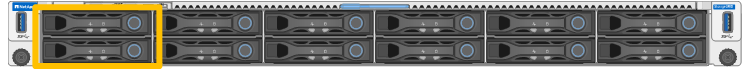
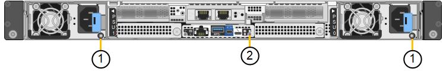
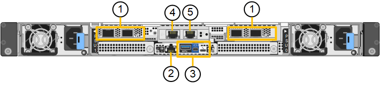
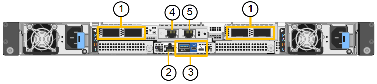

= StorageGRID SG120 和 SG1200 應用裝置
:allow-uri-read: 
:icons: font
:imagesdir: ../media/

[role="lead"]
StorageGRID SG120 服務應用裝置和 SG1200 服務應用裝置可作為閘道節點和管理節點運作，以在 StorageGRID 系統中提供高可用度負載平衡服務。這兩個應用裝置可同時作為閘道節點和管理節點（主要或非主要）運作。

== 應用裝置功能

SG120 和 SG1200 應用裝置提供下列功能：

* 閘道節點或管理節點功能StorageGRID 適用於一個不全系統。
* 旨在簡化節點部署與組態的《產品安裝程式（the StorageGRID
* 部署後、即可從StorageGRID 現有的管理節點或從下載到本機磁碟機的軟體存取此功能。為了進一步簡化部署程序、最新版軟體會在製造期間預先載入應用裝置。
* 用於監控和診斷部分應用裝置硬體的基礎板管理控制器（BMC）。
* 連線到所有三StorageGRID 個不完整網路的能力、包括Grid Network、管理網路和用戶端網路：
+
** SG120 支援最多四個 10 或 25 GbE 連接至 Grid Network 和 Client Network。
** SG1200 支援最多四個 10、25、40、100 GbE 連線至 Grid Network 和 Client Network（或使用選用的 200GbE NIC 最多四個 200GbE 連線）。

== SG120 與 SG1200 圖表

此圖顯示移除邊框後的 SG120 和 SG1200 正面。從正面看，這兩款產品除了邊框上的產品名稱外完全相同。

圖中橘色框線所示的兩塊固態硬碟 (SSD) 用於儲存 StorageGRID 作業系統，並使用 RAID 1 進行鏡像以實現備援。當 SG120 或 SG1200 服務應用裝置設定為管理節點時，這些磁碟機可用於儲存稽核記錄、指標和資料庫表格。其餘磁碟機插槽為空白。

此圖顯示 SG120 和 SG1200 背面的電源供應器和識別 LED 的位置。應用裝置連接埠上還有其他狀態和活動 LED。這些 LED 可能因應用裝置機型而異。

[cols="1a,2a,3a"]
|===
| 標註 | LED | 州/省 

 a| 
1.
 a| 
電源供應器 LED
 a| 
* 綠色、持續亮起：電源供應至產品、電源按鈕開啟。
* 綠色、閃爍：電源供應至產品、電源按鈕關閉。
* 熄滅：產品未通電。
* 琥珀色：電源供應器故障。

 a| 
2.
 a| 
識別 LED
 a| 
* 藍色、閃爍：表示設備位於機櫃或機架中。
* 藍色、恆亮：識別機櫃或機架中的設備。
* 關閉：設備在機櫃或機架中無法以視覺方式識別。

|===

== SG120 連接器

此圖顯示 SG120 的背面，包括連接埠、風扇和電源供應器。

[cols="1a,2a,2a,2a"]
|===
| 標註 | 連接埠 | 類型 | 使用 

 a| 
1.
 a| 
網路連接埠1-4
 a| 
10/25-GbE、根據纜線或SFP收發器類型（支援SFP28和SFP+模組）、交換器速度和設定的連結速度
 a| 
連線到Grid Network和Client Network for StorageGRID the

 a| 
2.
 a| 
BMC管理連接埠
 a| 
1-GbE（RJ-45）
 a| 
連接至應用裝置基板管理控制器。

 a| 
3.
 a| 
診斷與支援連接埠
 a| 
* Mini display 埠
* USB 3.0 連接埠
* Micro-USB 主控台連接埠

 a| 
保留以供技術支援使用。

 a| 
4.
 a| 
管理網路連接埠1
 a| 
1/10-GbE （ RJ-45 ）
 a| 
將應用裝置連接至管理網路StorageGRID 以供其使用。

 a| 
5.
 a| 
管理網路連接埠2.
 a| 
1/10-GbE （ RJ-45 ）
 a| 
選項：

* 與管理連接埠1連結、以建立與管理網路StorageGRID 的備援連線、以利執行支援。
* 保持中斷連線、可用於暫用本機存取（IP 169.254.0.1）。
* 安裝期間、如果 DHCP 指派的 IP 位址無法使用、請使用連接埠 2 進行 IP 組態。

|===

== SG1200 連接器

此圖顯示 SG1200 背面的連接器。

[cols="1a,2a,2a,2a"]
|===
| 標註 | 連接埠 | 類型 | 使用 

 a| 
1.
 a| 
網路連接埠1-4
 a| 
根據纜線或收發器類型、交換器速度和設定的連結速度，可提供 10/25/40/100/200-GbE。

原生支援 QSFP56（最高 200GbE/port）、QSFP28（最高 100GbE/port）和 QSFP+（40GbE）（200GbE 速度需要 200GbE NIC 選項）。選用的 SFP+（10GbE）或 SFP28（25GbE）收發器可與 QSA（單獨銷售）搭配使用。
 a| 
連線到Grid Network和Client Network for StorageGRID the

 a| 
2.
 a| 
BMC管理連接埠
 a| 
1-GbE（RJ-45）
 a| 
連接至應用裝置基板管理控制器。

 a| 
3.
 a| 
診斷與支援連接埠
 a| 
* Mini display 埠
* USB 3.0 連接埠
* Micro-USB 主控台連接埠

 a| 
保留以供技術支援使用。

 a| 
4.
 a| 
管理網路連接埠1
 a| 
1/10-GbE （ RJ-45 ）
 a| 
將應用裝置連接至管理網路StorageGRID 以供其使用。

 a| 
5.
 a| 
管理網路連接埠2.
 a| 
1/10-GbE （ RJ-45 ）
 a| 
選項：

* 與管理連接埠1連結、以建立與管理網路StorageGRID 的備援連線、以利執行支援。
* 保持中斷連線、可用於暫用本機存取（IP 169.254.0.1）。
* 安裝期間、如果 DHCP 指派的 IP 位址無法使用、請使用連接埠 2 進行 IP 組態。

|===

== SG120 與 SG1200 應用程式

您可以透過以下方式設定 StorageGRID 服務應用裝置，以提供閘道服務以及部分網格管理服務的備援。

* 將新的或現有的網格新增為閘道節點
* 將新網格新增為主要或非主要管理節點、或新增至現有網格作為非主要管理節點
* 同時以閘道節點和管理節點（主要或非主要）的形式運作

應用裝置可協助使用高可用度（HA）群組、並為S3或Swift資料路徑連線提供智慧型負載平衡。

下列範例說明如何最大化應用裝置的功能：

* 使用兩台 SG120 或兩台 SG1200 應用裝置，將它們設定為閘道節點，以提供閘道服務。
+

IMPORTANT: 在同一站台中混合使用效能等級不同的服務應用裝置，例如將 SG110 或 SG120 與 SG1100 或 SG1200 混合使用，在高可用性群組中使用多個節點或在多個服務應用裝置之間平衡用戶端負載時，可能會導致無法預測且不一致的結果

* 使用兩台 SG120 或兩台 SG1200 應用裝置，為部分網格管理服務提供備援。做法是將每個應用裝置設定為管理節點。
* 使用兩台 SG120 或兩台 SG1200 設備，透過一個或多個虛擬 IP 位址提供高可用性負載平衡和流量整形服務。做法是將設備設定為管理節點或閘道節點的任意組合，並將兩個節點新增至同一個 HA 群組。
+

IMPORTANT: 如果您在同一個 HA 群組中使用僅限 Admin Node 的連接埠和 Gateway Node，僅限 Admin Node 的連接埠將不會容錯移轉。請參閱 https://docs.netapp.com/us-en/storagegrid/admin/configure-high-availability-group.html["設定 HA 群組"^]的說明。

與 StorageGRID 儲存應用裝置搭配使用時，SG120 與 SG1200 服務應用裝置皆可部署僅包含應用裝置的網格，而無需依賴外部 Hypervisor 或運算硬體。
