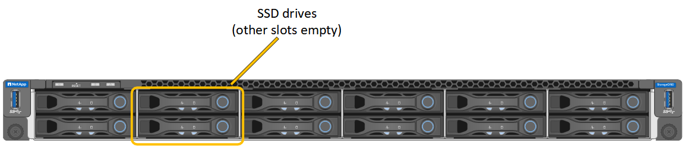
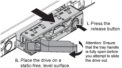
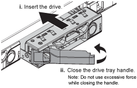

= 更換 SG100 或 SG1000 中的磁碟機
:allow-uri-read: 
:icons: font
:imagesdir: ../media/

[role="lead"]
服務應用裝置中的SSD包含StorageGRID 了不實的作業系統。此外、當設備設定為管理節點時、SSD也會包含稽核記錄、度量和資料庫表格。磁碟機使用RAID1進行鏡射、以提供備援功能。如果其中一個磁碟機故障、您必須儘快更換、以確保備援。

.開始之前
* 您有 link:locating-controller-in-data-center.html["實際放置設備"]。
* 您已確認哪個磁碟機故障、但其左LED指示燈呈黃色閃爍。
+
兩個 SSD 放在插槽中、如下圖所示：

+

+

CAUTION: 如果您移除工作正常的磁碟機、就會關閉應用裝置節點。請參閱檢視狀態指標以驗證故障的相關資訊。

* 您已取得替換磁碟機。
* 您已獲得適當的電子軟碟保護。

.步驟
. 驗證要更換的磁碟機的左側 LED 是否閃爍琥珀色。如果 Grid Manager 或 BMC 使用者介面中回報磁碟機問題、 HDD02 或 HDD2 會參考上插槽中的磁碟機、而 HDD03 或 HDD3 則會參考下插槽中的磁碟機。
+
您也可以使用 Grid Manager 來監控 SSD 的狀態。選取 *Nodes* 。然後選取 `*Appliance Node*` > *Hardware* 。如果磁碟機故障、 Storage RAID Mode 欄位會包含有關哪個磁碟機故障的訊息。

. 將防靜電腕帶的綁帶末端包覆在您的腕帶上、並將扣夾末端固定在金屬接地上、以避免產生靜電。
. 打開備用磁碟機的包裝、並將其放在產品附近無靜電且水平的表面上。
+
儲存所有包裝材料。

. 按下故障磁碟機上的釋放按鈕。
+

+
磁碟機上的握把會部分開啟、而磁碟機會從插槽中釋放。

. 打開握把、將磁碟機滑出、然後將其放在無靜電且水平的表面上。
. 在將替換磁碟機插入磁碟機插槽之前、請先按下釋放按鈕。
+
栓鎖會彈開。

+

. 將替換磁碟機插入插槽、然後關閉磁碟機握把。
+

CAUTION: 請勿在關閉握把時過度施力。

+
當磁碟機完全插入時、您會聽到「喀」一聲。

+
系統會自動使用正常硬碟的鏡像資料重建硬碟。您可以使用 Grid Manager 查看重建狀態。選擇 *Nodes* 。然後選擇 `*Appliance Node*` > *Hardware* 。在硬碟完全重建完成之前、 Storage RAID Mode 欄位會顯示「 `rebuilding` 」訊息。

更換零件後，請依照套件隨附的 RMA 說明將故障零件退回至 NetApp。如需詳細資訊，請參閱 https://mysupport.netapp.com/site/info/rma["零件退貨與更換"^]頁面。
