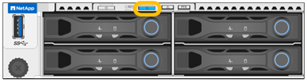

= 在資料中心找到 SG120 或 SG1200
:allow-uri-read: 
:icons: font
:imagesdir: ../media/

[role="lead"]
找到應用裝置、以便執行硬體維護或升級。

.開始之前
* 您已確定哪些應用裝置需要維護。
* 為了幫助您在資料中心找到該設備，link:turning-sg120-and-sg1200-identify-led-on-and-off.html["開啟藍色識別LED"]。

.步驟
. 在資料中心找到應用裝置。
+
** 請查看產品正面或背面是否有亮起的藍色識別 LED 。
+
前端識別 LED 位於前擋板後方、可能很難查看是否已安裝擋板。

+

+
背面識別 LED 位於應用裝置中央，Micro-SD 插槽旁。

** 檢查產品正面的標籤、以取得相符的零件編號、確認您找到正確的產品。

. 卸下前擋板（如果安裝了前擋板），以查看前面板控制按鈕和指示燈。
. link:turning-sg120-and-sg1200-identify-led-on-and-off.html["關閉藍色識別 LED"] 如果您使用它來定位應用裝置。
+
** 按下產品前面板上的識別 LED 開關。
** 使用應用裝置 BMC 介面。

