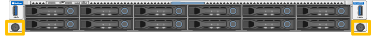
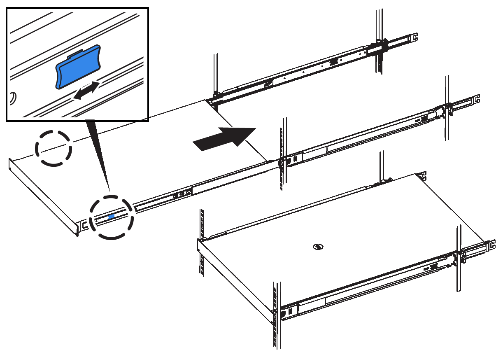

= 將 SG120 和 SG1200 重新放置在機櫃或機架中
:allow-uri-read: 
:icons: font
:imagesdir: ../media/

[role="lead"]
將 SG120 或 SG1200 從機櫃或機架中取出，以便存取頂蓋或將應用裝置移至其他位置，硬體維護完成後，再將應用裝置重新安裝到機櫃或機架中。

.開始之前
* 您有標籤可識別連接至 SG120 或 SG1200 的每條纜線。
* 您有link:locating-sg120-and-sg1200-in-data-center.html["SG120 或 SG1200 的實體位置"]在資料中心執行維護作業。
* 您有 link:power-sg120-and-sg1200-off-on.html#shut-down-the-sg120-or-sg1200-appliance["關閉 SG120 或 SG1200"]。
+

CAUTION: 請勿使用電源開關關閉產品。

[[step-1-remove-sg120-or-sg1200-from-cabinet-or-rack]]
[[remove-from-rack]]
== 步驟 1：從機櫃或機架取出 SG120 或 SG1200

.步驟
. 標示產品電源纜線、然後拔下產品電源纜線。
. 將防靜電腕帶的綁帶末端包覆在您的腕帶上、並將扣夾末端固定在金屬接地上、以避免產生靜電。
. 貼上標籤，然後中斷設備資料纜線和任何 SFP+、SFP28 或 SFP56 收發器的連線。
+

IMPORTANT: 為避免效能降低、請勿在纜線上扭轉、摺疊、夾住或踩踏。

. 鬆開產品前面板上的兩顆緊固螺絲。
+

. 將 SG120 或 SG1200 向前滑出機架，直到安裝導軌完全伸出，並且聽到兩側的閂鎖發出咔嗒聲。
+
產品頂蓋可供使用。

+

NOTE: 如果您要將應用裝置從機櫃或機架上完全移除，請依照滑軌套件的說明將應用裝置從滑軌上移除。

[[step-2-reinstall-sg120-or-sg1200-into-cabinet-or-rack]]
== 步驟 2：將 SG120 或 SG1200 重新安裝到機櫃或機架中

.步驟
. 同時按下兩個機架導軌上的藍色導軌釋放鈕，將 SG120 或 SG1200 滑入機架，直到完全就位。
+
如果您無法進一步移動控制器、請拉動機箱兩側的藍色閂鎖、將控制器完全滑入。

+

+

NOTE: 在您開啟控制器電源之前、請勿連接前擋板。

. 鎖緊控制器前面板上的緊固螺絲、將控制器固定在機架中。
+

. 將防靜電腕帶的綁帶末端包覆在您的腕帶上、並將扣夾末端固定在金屬接地上、以避免產生靜電。
. link:../installconfig/cabling-appliance.html["重新連接控制器資料纜線和任何 SFP 收發器"]。
+

IMPORTANT: 為避免效能降低、請勿在纜線上扭轉、摺疊、夾住或踩踏。

. link:../installconfig/connecting-power-cords-and-applying-power.html["重新連接控制器電源線"]。
. link:power-sg120-and-sg1200-off-on.html#power-on-sg120-or-sg1200-and-verify-operation["重新啟動應用裝置"]。

