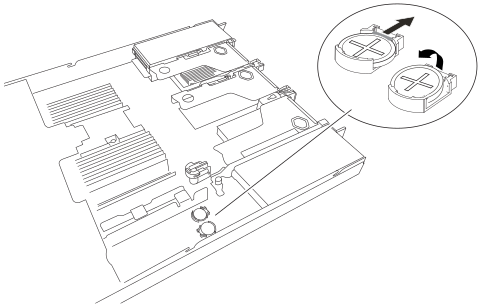

= 更換 SG120 或 SG1200 中的 CMOS 電池
:allow-uri-read: 
:icons: font
:imagesdir: ../media/

[role="lead"]
請依照以下步驟更換系統板上的兩顆 CMOS 鈕扣電池。

.關於這項工作
為防止服務中斷，請在開始更換 CMOS 電池之前，確認所有其他服務應用裝置均已連接到網格，並且已配置高可用性群組（如適用）；或在計劃的維護時段期間更換電池，前提是允許服務中斷一段時間。請參閱相關資訊 https://docs.netapp.com/us-en/storagegrid/monitor/monitoring-system-health.html#monitor-node-connection-states["監控節點連線狀態"^]。

.開始之前
* 您有 link:verify-component-to-replace.html["已確認 SG120 或 SG1200 的 CMOS 電池需要更換"]。
* 您已獲得正確的替換 CMOS 電池（CR2032）。
* 您有link:locating-sg120-and-sg1200-in-data-center.html["SG120 或 SG1200 應用裝置的實際位置"]，您正在資料中心更換 CMOS 電池。
* 您已記錄應用裝置目前的 BMC 組態（如果仍可用）。
+
.. 登入要更換的應用裝置：
+
... 輸入下列命令： `ssh admin@_grid_node_IP_`
... 輸入中所列的密碼 `Passwords.txt` 檔案：
... 輸入下列命令以切換至root： `su -`
... 輸入中所列的密碼 `Passwords.txt` 檔案：
+
當您以root登入時、提示會從變更 `$` 至 `#`。

.. 輸入： `*run-host-command ipmitool lan print*`顯示應用裝置目前的 BMC 組態。
+

NOTE: 從機架中移除應用裝置之前，需要 link:power-sg120-and-sg1200-off-on.html#shut-down-the-sg120-or-sg1200-appliance["受控制的產品關機"]。

* 您已中斷所有纜線的連線並link:reinstalling-sg120-and-sg1200-cover.html["已取下產品護蓋"]。

.步驟
. 將防靜電腕帶的綁帶末端包覆在您的腕帶上、並將扣夾末端固定在金屬接地上、以避免產生靜電。
. 取出第一顆 CMOS 電池。
+
.. 找到系統板上的 CMOS 電池。
.. 使用手指或塑膠撬起工具、將固定夾從電池上壓下、即可將其從插槽中彈出。
+

.. 取出電池並妥善棄置。

. 安裝替換用的 CMOS 電池。
+
.. 從包裝中取出更換用 CMOS 電池。
.. 將替換電池按入主機板上的空插槽、使正極（ + ）面朝上、直到電池卡入定位。

. 對第二個 CMOS 電池重複這些步驟。
. 如果您沒有其他維護程序可以在產品中執行、請重新安裝產品護蓋、將產品放回機架、連接纜線並接上電源。
. 如果您更換的應用裝置已啟用 SED 磁碟機的磁碟機加密、則您必須 link:../installconfig/optional-enabling-node-encryption.html#access-an-encrypted-drive["輸入磁碟機加密密碼"] 可在第一次啓動更換設備時訪問加密的驅動器。
. 如果您更換的應用裝置使用金鑰管理伺服器（ KMS ）來管理節點加密的加密金鑰、則可能需要額外的組態、節點才能加入網格。如果節點未自動加入網格、請確定這些組態設定已傳輸至新應用裝置、並手動設定任何沒有預期組態的設定：
+
** link:../installconfig/accessing-storagegrid-appliance-installer.html["設定 StorageGRID 連線"]
** https://docs.netapp.com/us-en/storagegrid/admin/kms-overview-of-kms-and-appliance-configuration.html#set-up-the-appliance["設定應用裝置的節點加密"^]

. 登入應用裝置：
+
.. 輸入下列命令： `ssh admin@_grid_node_IP_`
.. 輸入中所列的密碼 `Passwords.txt` 檔案：
.. 輸入下列命令以切換至root： `su -`
.. 輸入中所列的密碼 `Passwords.txt` 檔案：

. 使用下列選項之一恢復應用裝置的 BMC 網路連線：
+
** 使用靜態 IP 、網路遮罩和閘道
** 使用 DHCP 取得 IP 、網路遮罩和閘道
+
... 若要還原 BMC 組態以使用靜態 IP 、網路遮罩和閘道、請輸入下列命令：
+
`*run-host-command ipmitool lan set 1 ipsrc static*`

+
`*run-host-command ipmitool lan set 1 ipaddr _Appliance_IP_*`

+
`*run-host-command ipmitool lan set 1 netmask _Netmask_IP_*`

+
`*run-host-command ipmitool lan set 1 defgw ipaddr _Default_gateway_*`

... 若要還原 BMC 組態以使用 DHCP 取得 IP 、網路遮罩和閘道、請輸入下列命令：
+
`*run-host-command ipmitool lan set 1 ipsrc dhcp*`

. 還原 BMC 網路連線之後、請連線至 BMC 介面以稽核及還原您可能已套用的任何其他自訂 BMC 組態。例如、您應該確認 SNMP 設陷目的地和電子郵件通知的設定。請參閱 link:../installconfig/configuring-bmc-interface.html["設定 BMC 介面"]。
. 確認應用裝置節點出現在Grid Manager中、且未顯示任何警示。

