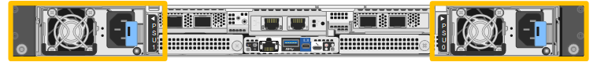
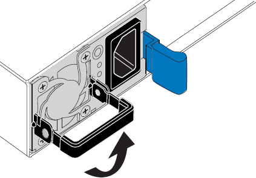
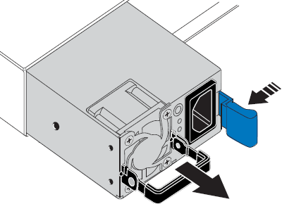
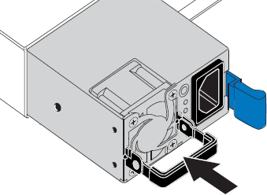

= 更換 SG120 或 SG1200 中的一個或兩個電源供應器
:allow-uri-read: 
:icons: font
:imagesdir: ../media/

[role="lead"]
SG120 和 SG1200 應用裝置配備兩個電源供應器，以實現備援。如果其中一個電源供應器故障，您必須盡快更換，以確保應用裝置具有備援電源。應用裝置中運作的兩個電源供應器必須具有相同的型號和瓦數。

.關於這項工作
圖中顯示了 SG120 和 SG1200 的兩個電源單元。電源單元可從設備背面存取。

.開始之前
* 您有link:locating-sg120-and-sg1200-in-data-center.html["實際放置設備"]需要更換電源。
* 您有 link:verify-component-to-replace.html["已確定要更換的電源的位置"]。
* 如果您只要更換一個電源供應器：
+
** 您已將更換的電源供應器解壓縮、並確保其型號與瓦數與您要更換的電源供應器相同。
** 您已確認其他電源供應器已安裝並正在執行。

* 如果同時更換兩個電源供應器，請確保它們的型號和功率相同。

.步驟
. 如果只更換一個電源供應器，則無需關閉應用裝置。前往<<Unplug_the_power_cord,拔下電源線>>步驟。如果同時更換兩個電源供應器，請link:power-sg120-and-sg1200-off-on.html#shut-down-the-sg120-or-sg1200-appliance["關閉產品電源"]再拔下電源線。
. [拔 下_the_電源線、start=2]]從每個要更換的電源供應器拔下電源線。
+
從產品背面看、電源 A （ PSU0 ）位於右側、電源 B （ PSU1 ）位於左側。

. 提起第一個要更換的耗材的把手。
+

. 按下藍色栓鎖、將電源供應器拉出。
+

. 在右側的藍色栓鎖中、將替換電源供應器滑入機箱。
+

IMPORTANT: 兩個安裝的電源必須是相同的機型和瓦數。

+
將替換單元滑入時、請確定藍色栓鎖位於右側。

+
當電源供應器鎖定到位時、您會感到卡入。

+

. 將把手向下推入 PSU 的主體。
. 如果您要更換兩個電源供應器、請重複步驟2到6以更換第二個電源供應器。
. link:../installconfig/connecting-power-cords-and-applying-power.html["將電源線連接至更換的裝置並接上電源"]。

更換零件後，請依照套件隨附的 RMA 說明將故障零件退回至 NetApp。如需詳細資訊，請參閱 https://mysupport.netapp.com/site/info/rma["零件退貨與更換"^]頁面。
