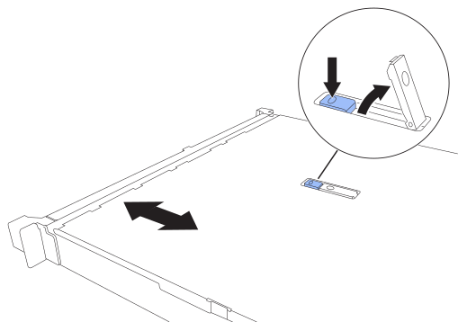

= 更換 SGF6212 或 SG6200-CN 護蓋
:allow-uri-read: 
:icons: font
:imagesdir: ../media/

[role="lead"]
取下產品外蓋以檢修內部組件以進行維護、完成後請裝回外蓋。

== 步驟 1：取下護蓋

.步驟
. 將 ESD 腕帶的束帶端繞在手腕上、並將扣具端點固定在金屬地面上、以防止在產品內部工作時發生靜電釋放。
. link:reinstalling-sg6200-into-cabinet-or-rack.html["將產品從機櫃或機架中取出"] 以存取頂蓋。

. 按下設備護蓋上的藍色鎖定按鈕，即可解鎖護蓋閂鎖。
+

. 將閂鎖朝產品機箱的後端向上或向後轉動、直到卡入定位為止、然後小心地將機箱蓋從機箱中提出、並將其放在一邊。

== 步驟 2：重新安裝護蓋

.步驟
. 打開護蓋閂鎖後，將護蓋對準機箱上方並小心放下。
. 向前或向下轉動機箱蓋栓鎖、直到其停止、並將機箱蓋完全裝入機箱。確認機箱蓋前緣沒有任何間隙。
+
如果機箱蓋未完全就位、您可能無法將產品滑入機架。

. link:reinstalling-sg6200-into-cabinet-or-rack.html["將產品重新安裝在機櫃或機架中"]。

