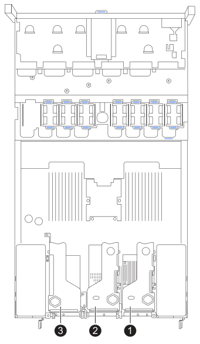
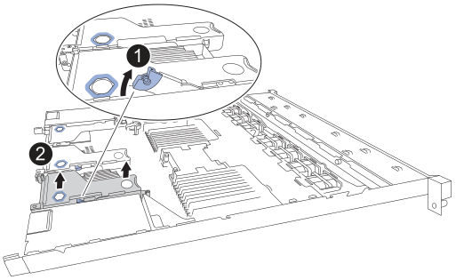
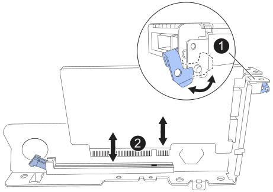
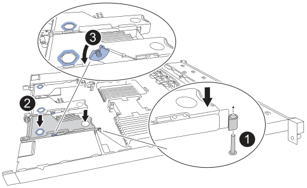
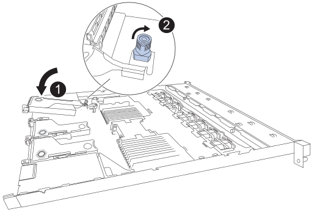

= 更換 SGF6212 或 SG6200-CN 中的內部 NIC
:allow-uri-read: 
:icons: font
:imagesdir: ../media/

[role="lead"]
如果 SGF6212 或 SG6200-CN 中的內部網路介面卡（NIC）運作不佳或發生故障，則可能需要更換該 NIC。

.關於這項工作
為避免服務中斷、請在開始更換網路介面卡（ NIC ）之前、確認所有其他儲存節點都已連線至網格、或在可接受服務中斷期間的排程維護期間更換 NIC 。請參閱的相關資訊 https://docs.netapp.com/us-en/storagegrid/monitor/monitoring-system-health.html#monitor-node-connection-states["監控節點連線狀態"^]。

CAUTION: 如果您曾經使用過僅建立一個物件複本的 ILM 規則、則必須在排程的維護期間更換 NIC 、因為在此程序期間可能會暫時失去這些物件的存取權。請參閱的相關資訊 https://docs.netapp.com/us-en/storagegrid/ilm/why-you-should-not-use-single-copy-replication.html["為何不應使用單一複本複寫"^]。

.開始之前
* 您擁有正確的替換 NIC 。
* 您有link:locating-sg6200-in-data-center.html["實際找到 SGF6212 應用裝置或 SG6200-CN 控制器的位置"]需要更換資料中心的 NIC。
+

NOTE: 從機架中移除應用裝置之前，需要 link:power-sg6200-off-on.html#shut-down-the-sgf6212-appliance-or-sg6200-cn-controller["受控制的產品關機"]。

* 您已中斷所有纜線的連線，並link:reinstalling-sg6200-cover.html["已取下產品護蓋"]。
* 您已決定 link:verify-component-to-replace.html["要更換的 NIC 的位置"]。
+
設備中的三個 NIC 位於機箱內三個轉接卡組件中的以下位置（圖中所示為移除頂蓋後的設備背面）：

+

== 步驟 1：移除 NIC

[role="tabbed-block"]
====
.NIC 1/NIC 2
--
.步驟
. 將防靜電腕帶的綁帶末端包覆在您的腕帶上、並將扣夾末端固定在金屬接地上、以避免產生靜電。
. 找到設備背面包含 NIC 的擴充卡組件。
. 將故障 NIC 所在的擴充卡上的藍色鎖定閂向上旋轉並打開。
+

. 小心地使用藍色標記的孔位向上提起故障 NIC 的提升板組件。提起提升板組件時，將其向機箱前方移動，以便其上安裝的 NIC 的外部連接器能夠脫離機箱。
. 將立管放置在平坦的防靜電表面上，金屬框架朝下，以便存取 NIC。
. 打開故障 NIC 上的藍色卡扣，小心地將其從轉接卡組件中取出。輕輕搖晃 NIC，幫助其脫離連接器。切勿用力過猛。
+

. 將立管和 NIC 放置在平坦的防靜電表面上。

--
.NIC 3
--
.步驟
. 將防靜電腕帶的綁帶末端包覆在您的腕帶上、並將扣夾末端固定在金屬接地上、以避免產生靜電。
. 將故障 NIC 所在的立管上的藍色鎖旋轉到開啟位置。
+

. 小心地利用藍色標記孔和提升卡邊緣向上提起提升卡組件。提起時，將提升卡組件向機箱前方移動，以便其安裝的 NIC 上的外部連接器能夠避開機箱。
. 將立管放置在平坦的防靜電表面上，金屬框架朝下，以便存取 NIC。
. 打開故障 NIC 上的藍色卡扣，小心地將其從轉接卡組件中取出。輕輕搖晃 NIC，幫助其脫離連接器。切勿用力過猛。
+

. 將立管和 NIC 放置在平坦的防靜電表面上。

--
====

== 步驟 2：重新安裝內建 NIC

將更換的 NIC 安裝到與移除的 NIC 相同的位置。

[role="tabbed-block"]
====
.NIC 1/NIC 2
--
.步驟
. 將防靜電腕帶的綁帶末端包覆在您的腕帶上、並將扣夾末端固定在金屬接地上、以避免產生靜電。
. 從包裝中取出更換的 NIC 。
. 將替換 NIC 安裝到提升卡組件中。
+
.. 確定藍色栓鎖處於開啟位置。
+

.. 將 NIC 與立管組件上的連接器對齊。小心地將 NIC 按入連接器，直到完全到位，然後合上藍色閂鎖。

. 將提升板組件重新安裝到機箱中。
+
.. 找到轉接卡組件上的對準孔，使其與系統板上的導引銷對齊，以確保轉接卡組件正確定位。
+

.. 將轉接器組件放入機箱中、確定其對齊主機板上的連接器和導引針。
.. 小心地沿着藍色標記孔旁的中心線將提升部件按入到位，直到其完全就位。

. 如果您沒有其他維護程序可以在產品中執行、請重新安裝產品護蓋、將產品放回機架、連接纜線並接上電源。

更換零件後，請依照套件隨附的 RMA 說明將故障零件退回至 NetApp。如需詳細資訊，請參閱 https://mysupport.netapp.com/site/info/rma["零件退貨與更換"^]頁面。

--
.NIC 3
--
.步驟
. 將防靜電腕帶的綁帶末端包覆在您的腕帶上、並將扣夾末端固定在金屬接地上、以避免產生靜電。
. 從包裝中取出更換的 NIC 。
. 將替換 NIC 安裝到提升卡組件中。
+
.. 確定藍色栓鎖處於開啟位置。
+

.. 將 NIC 與立管組件上的連接器對齊。小心地將 NIC 按入連接器，直到完全到位，然後合上藍色閂鎖。

. 將提升板組件重新安裝到機箱中。
+
.. 將提升板組件放入機箱中，確保提升板組件的邊緣與機箱的邊緣正確對齊。
+

.. 小心地將提升板組件沿著中心線按入到位，靠近藍色標記的孔，直到完全就位。
.. 將立管上的藍色鎖旋轉到關閉位置。

. 從要重新安裝纜線的 NIC 連接埠取下保護蓋。
. 如果您沒有其他維護程序可以在產品中執行、請重新安裝產品護蓋、將產品放回機架、連接纜線並接上電源。

更換零件後，請依照套件隨附的 RMA 說明將故障零件退回至 NetApp。如需詳細資訊，請參閱 https://mysupport.netapp.com/site/info/rma["零件退貨與更換"^]頁面。

--
====