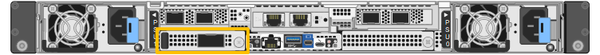

= 更換 SG6200-CN 中的外部網路卡
:allow-uri-read: 
:icons: font
:imagesdir: ../media/

[role="lead"]
如果 SG6200-CN 中的外部網路介面卡（NIC）運作不佳或發生故障，您可能需要更換該外部網路介面卡。

.關於這項工作
若要防止服務中斷，請在開始更換網路介面卡（NIC）之前確認所有其他儲存節點已連接至網格，或在可接受服務中斷期間的排程維護時段內更換 NIC。請參閱link:https://docs.netapp.com/us-en/storagegrid/monitor/monitoring-system-health.html#monitor-node-connection-states["繫泊節點連線狀態"]的相關資訊。

CAUTION: 如果您曾經使用過僅建立物件單一副本的 ILM 規則，則必須在計劃的維護視窗期間更換 NIC，因為在此程序期間您可能會暫時失去對這些物件的存取。請參閱link:https://docs.netapp.com/us-en/storagegrid/ilm/why-you-should-not-use-single-copy-replication.html["為何不應使用單一複本複寫"]相關資訊。

.開始之前
* 您擁有正確的替換 NIC 。
* 您已決定 link:verify-component-to-replace.html["要更換的 NIC 的位置"]。
+

* 您有link:locating-sg6200-in-data-center.html["實體定位 SG6200-CN 控制器"]需要更換資料中心的 NIC。
+

NOTE: 此程序*不*支援熱插拔。在中斷纜線連線並移除 NIC 之前，需要 link:power-sg6200-off-on.html#shut-down-the-sgf6212-appliance-or-sg6200-cn-controller["受控制的產品關機"]。

* 您已中斷所有纜線的連線、包括 SG6200-CN 上的兩條電源線。
* * 可選 * ：如果當地法規要求，您已將控制器從機架中移除。由於 NIC 可從外部存取、因此不需要移除。

[[step-1-remove-the-external-nic]]
== 步驟 1：移除外部 NIC

.步驟
. 將 ESD 腕帶的束帶端繞在手腕上、並將扣具端點固定在金屬接地上、以防止靜電釋放。
. 使用螺絲起子鬆開 NIC 面板上的螺絲。
+

CAUTION: 此程序 * 不 * 支援熱交換。移除 NIC 之前、必須先中斷控制器的電源。

. 拉住面板把手、小心地取下 NIC 。將 NIC 放置在平坦的防靜電表面上。

[[step-2-reinstall-the-external-nic]]
== 步驟 2：重新安裝外部 NIC

.步驟
. 將 ESD 腕帶的束帶端繞在手腕上、並將扣具端點固定在金屬接地上、以防止靜電釋放。
. 從包裝中取出更換的 NIC 。
. 將 NIC 與機箱中的開口對齊、然後小心地將其推入、直到完全就位。
. 旋緊 NIC 面板上的螺絲。

.完成後
如果您沒有其他維護程序可在產品中執行、請在產品移除後將產品送回機架、連接纜線並接上電源。

更換零件後，請依照套件隨附的 RMA 說明將故障零件退回至 NetApp。如需詳細資訊，請參閱 https://mysupport.netapp.com/site/info/rma["零件退貨與更換"^]頁面。
