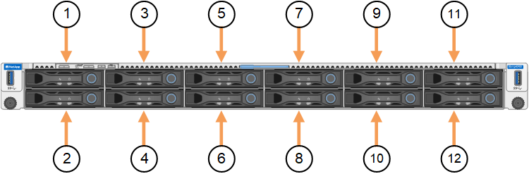

= 更換 SGF6212 中的磁碟機
:allow-uri-read: 
:icons: font
:imagesdir: ../media/

[role="lead"]
SGF6212 儲存設備包含 12 個 SSD 磁碟機。當 SGF6212 作為儲存節點運作時，磁碟機上的資料受 RAID 方案保護，即使單一磁碟機發生故障，應用裝置也能恢復，無需從其他節點複製資料。當 SGF6212 作為閘道節點運作時，單一磁碟機故障會導致快取容量減少。

如果 SGF6212 作為儲存節點運作，在初始磁碟機故障修正之前第二個磁碟機發生故障，可能需要從其他節點複製資料以還原備援。如果目前或過去使用過單一複本 ILM 規則，或資料備援受到其他節點故障的影響，則還原備援可能需要更長時間，甚至可能無法還原。因此，如果 SGF6212 的其中一個磁碟機發生故障，您必須盡快更換，以確保備援。

如果 SGF6212 作為閘道節點運作，則 SGF6212 中的每個磁碟機故障都會導致快取容量進一步減少。此外，故障磁碟機上的任何快取資料將不再被快取。其他磁碟機故障可能會導致作業系統故障，因此您必須盡快更換故障磁碟機以確保可用性。

CAUTION: 如果三個或更多磁碟機發生故障，節點可能無法執行 StorageGRID。它將退出網格，重新開機，並啟動 StorageGRID Appliance Installer 以便診斷和修復儲存問題。

.開始之前
* 您有link:locating-sg6200-in-data-center.html["實際放置設備"]。
* 您已確認哪個磁碟機發生故障、方法是注意磁碟機的左 LED 燈為穩定琥珀色、或使用 Grid Manager 來 link:verify-component-to-replace.html["檢視故障磁碟機所造成的警示"]。
+

NOTE: 請參閱檢視狀態指標以驗證故障的相關資訊。

* 您已取得替換磁碟機。
* 您已獲得適當的電子軟碟保護。

.步驟
. 驗證磁碟機的左側故障 LED 是否為琥珀色、或使用警示中的磁碟機插槽 ID 來找出磁碟機。
+
12 個磁碟機位於機箱的下列位置（圖示為卸下擋板的機箱正面）：

+

+
|===
| 定位 | 磁碟機 

 a| 
1.
 a| 
HDD00

 a| 
2.
 a| 
HDD01

 a| 
3.
 a| 
HDD02

 a| 
4.
 a| 
HDD03

 a| 
5.
 a| 
HDD04

 a| 
6.
 a| 
HDD05

 a| 
7.
 a| 
HDD06

 a| 
8.
 a| 
HDD07

 a| 
9.
 a| 
HDD08

 a| 
10.
 a| 
HDD09

 a| 
11.
 a| 
HDD10

 a| 
12.
 a| 
HDD11.

|===
+
您也可以使用 Grid Manager 來監控 SSD 磁碟機的狀態。選取 *Nodes* 。然後選取 `*Storage Node*` > *Hardware* 。如果磁碟機故障、 Storage RAID Mode 欄位會包含有關哪個磁碟機故障的訊息。

. 將防靜電腕帶的綁帶末端包覆在您的腕帶上、並將扣夾末端固定在金屬接地上、以避免產生靜電。
. 打開備用磁碟機的包裝、並將其放在產品附近無靜電且水平的表面上。
+
儲存所有包裝材料。

. 按下故障磁碟機上的釋放按鈕。
+
image:../media/drw_s2025_drive_replace_ieops-2553.svg["從機箱中移除磁碟機"]

+
磁碟機上的握把會部分開啟、而磁碟機會從插槽中釋放。

. 打開握把、將磁碟機滑出、然後將其放在無靜電且水平的表面上。
. 在將替換磁碟機插入磁碟機插槽之前、請先按下釋放按鈕。
+
栓鎖會彈開。

. 將替換磁碟機插入插槽、然後關閉磁碟機握把。
+

NOTE: 請勿在關閉握把時過度施力。

+
當磁碟機完全插入時、您會聽到「喀」一聲。

+
更換的磁碟機會自動重建、並使用工作磁碟機的鏡射資料。磁碟機 LED 最初應該會閃爍、但系統一旦判斷磁碟機有足夠容量且正常運作、就會停止閃爍。

+
您可以使用Grid Manager來檢查重新建置的狀態。

. 如果 SGF6212 用作儲存節點，且多個磁碟機發生故障並已更換，您可能會收到警示，提示某些磁碟區需要還原資料。如果收到警示，請在嘗試磁碟區還原之前，選擇 *Nodes* > `*appliance Storage Node*` > *Hardware*。在頁面的 StorageGRID Appliance 區段中,確認 Storage RAID mode 狀態為正常或正在重建。如果狀態顯示一個或多個磁碟機發生故障，請在嘗試磁碟區還原之前解決此問題。
. 在 Grid Manager 中、前往 *Nodes* > `*appliance Storage Node*` > *Hardware* 。在頁面的 StorageGRID Appliance 區段中、確認 Storage RAID 模式是否正常。

更換零件後，請依照套件隨附的 RMA 說明將故障零件退回至 NetApp。如需詳細資訊，請參閱 https://mysupport.netapp.com/site/info/rma["零件退貨與更換"^]頁面。
