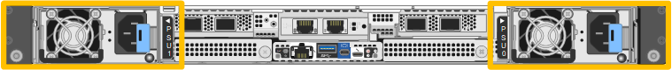

= 更換 SGF6212 或 SG6200-CN 中的一個或兩個電源供應器
:allow-uri-read: 
:icons: font
:imagesdir: ../media/

[role="lead"]
SGF6212 應用裝置和 SG6200-CN 運算節點配備兩個電源以實現備援。如果其中一個電源發生故障、您必須盡快更換、以確保應用裝置擁有備援電源。應用裝置中運作的兩個電源必須為相同的機型和瓦數。

.關於這項工作
圖中顯示了兩個電源供應器的位置。電源供應器可從應用裝置背面存取。

+ 注意：圖中顯示的是 SGF6212 應用裝置，但電源供應器在 SG6200-CN 運算節點上的位置相同。

.開始之前
* 您有link:locating-sg6200-in-data-center.html["實際放置設備"]需要更換電源。
* 您有 link:verify-component-to-replace.html["已確定要更換的電源的位置"]。
* 如果您只要更換一個電源供應器：
+
** 您已將更換的電源供應器解壓縮、並確保其型號與瓦數與您要更換的電源供應器相同。
** 您已確認其他電源供應器已安裝並正在執行。

* 如果您同時更換兩個電源供應器：
+
** 您已將更換的電源供應器解壓縮、並確保它們的型號和瓦數相同。

.步驟
. 如果您只要更換一個電源供應器、就不需要關閉產品電源。前往 <<Unplug_the_power_cord,拔下電源線>> 步驟。如果您同時更換兩個電源供應器、請在拔下電源線之前執行下列步驟：
+
.. link:power-sg6200-off-on.html#shut-down-the-sgf6212-appliance-or-sg6200-cn-controller["關閉產品電源"]。
+

CAUTION: 如果您曾經使用過僅建立一個物件複本的 ILM 規則、而且同時更換兩個電源供應器、則必須在排程維護期間更換電源供應器、因為在本程序期間、您可能會暫時失去這些物件的存取權。請參閱的相關資訊 https://docs.netapp.com/us-en/storagegrid/ilm/why-you-should-not-use-single-copy-replication.html["為何不應使用單一複本複寫"^]。

. [拔 下_the_電源線、start=2]]從每個要更換的電源供應器拔下電源線。
+
從產品背面看、電源 A （ PSU0 ）位於右側、電源 B （ PSU1 ）位於左側。

. 提起第一個要更換的耗材的把手。
+
image::../media/sg6000_cn_lift_cam_handle_psu.gif[抬起把手以移除 PSU]

. 按下藍色栓鎖、將電源供應器拉出。
+
image::../media/sg6000_cn_remove_power_supply.gif[卸下電源供應器]

. 在右側的藍色栓鎖中、將替換電源供應器滑入機箱。
+

NOTE: 兩個安裝的電源必須是相同的機型和瓦數。

+
將替換單元滑入時、請確定藍色栓鎖位於右側。

+
當電源供應器鎖定到位時、您會感到卡入。

+
image::../media/sg6000_cn_insert_power_supply.gif[滑入電源供應器]

. 將把手向下推入 PSU 的主體。
. 如果您要更換兩個電源供應器、請重複步驟2到6以更換第二個電源供應器。
. link:../installconfig/connecting-power-cords-and-applying-power.html["將電源線連接至更換的裝置並接上電源"]。

更換零件後，請依照套件隨附的 RMA 說明將故障零件退回至 NetApp。如需詳細資訊，請參閱 https://mysupport.netapp.com/site/info/rma["零件退貨與更換"^]頁面。
